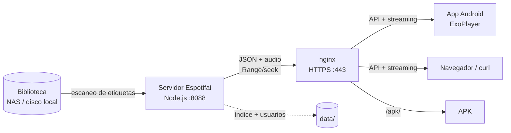

# Espotifai

**Tu música, en tu casa.** Servidor de streaming de música autoalojado, con app web y Android, cola, listas y descarga de álbumes en ZIP.

Espotifai escanea una carpeta con tu música (MP3, FLAC, M4A, OGG, OPUS, WAV, AAC), lee las etiquetas y las carátulas, y sirve la biblioteca por HTTP. La consumen una **app web** (sin instalar nada), una **app Android** (Kotlin + Compose + Media3) y cualquier reproductor que acepte una URL.

- Sin nube, sin suscripción y sin telemetría.
- Un servidor Node.js pequeño y una app Android.
- Streaming con `Range` (seek), carátulas, índice persistente y reescaneo.
- Tokens por usuario (admin + familia/dispositivos).
- App web con cola, listas y descarga ZIP por álbum; app Android con modo sin conexión, descargas, cola y listas.

---

## Arquitectura



| Pieza | Qué hace |
|---|---|
| **Biblioteca** | Carpeta `MUSIC_DIR` con `ARTISTA/ÁLBUM/NN-título.ext` (también admite pistas sueltas por artista). |
| **Servidor** | Escanea, indexa (`data/index.json`), sirve `/api/library`, `/api/stream/:id`, `/api/cover/:id` y gestiona usuarios. |
| **nginx** | Termina TLS, sirve `/apk/` y hace de reverse proxy. Opcional: el servidor también puede exponerse directo. |
| **App web** | `webapp/index.html`: biblioteca, búsqueda, reproductor, cola, listas y ZIP por álbum. |
| **App Android** | Biblioteca, búsqueda, reproductor, descargas, cola y listas. Guarda una caché local para funcionar sin red. |
| **Frontal** | `web/index.html`: portada del proyecto, documentación y enlace al repo. |

El detalle está en [`docs/ARQUITECTURA.md`](docs/ARQUITECTURA.md).

## Frontal e instancias

- **`espotifai.es`** es el frontal del proyecto: esta web, la documentación y el repositorio. **No sirve música.**
- Cada persona despliega su **instancia** en `micasa.espotifai.es`, con un CNAME a su DDNS (o un A a la IP de su casa).
- La instancia sirve la **app web**, la **API** y el **APK**:

```text
micasa.espotifai.es.  CNAME  tu-ddns.example.com.
```

Ejemplo: `micasa.espotifai.es` → `tu-ddns.example.com` → app web + API + APK.

> El frontal es estático. Los ejemplos de Docker Compose despliegan una instancia, no el frontal.


---

## Arranque rápido

### 1. Sin nginx (lo más simple)

```bash
git clone https://github.com/iwanttobefreak/espotifai.git
cd espotifai

cp .env.example .env
# edita .env: API_TOKEN y MUSIC_DIR
nano .env

docker compose up -d --build
```

Queda en `http://IP_DEL_SERVIDOR:8088`.

> Este ejemplo levanta solo la API. Para la app web usa el ejemplo con nginx o sirve `webapp/` con un servidor estático.

- `GET /api/health` para comprobar que responde.
- `GET /api/library?token=...` o cabecera `Authorization: Bearer ...`.
- La app se configura con la URL y el token.

Ejemplo completo: [`examples/sin-nginx/`](examples/sin-nginx/).

### 2. Con nginx y HTTPS (instancia)

Crea primero el CNAME de tu subdominio a tu casa:

```text
micasa.espotifai.es.  CNAME  tu-ddns.example.com.
```

```bash
cd examples/con-nginx
cp .env.example .env
nano .env
nano nginx.conf      # micasa.espotifai.es

docker compose up -d --build
```

La app web queda en `https://micasa.espotifai.es` y el APK en `/apk/`.

Después, emite el certificado (una sola vez) y descomenta el bloque `443` de `nginx.conf`:

```bash
docker compose run --rm certbot certonly --webroot -w /var/www/certbot \
  -d music.example.com --email tu@email.com --agree-tos --no-eff-email
docker compose restart nginx
```

Ejemplo completo: [`examples/con-nginx/`](examples/con-nginx/).

---

## Configuración

| Variable | Por defecto | Descripción |
|---|---|---|
| `API_TOKEN` | *(vacío)* | Token **admin**. Si se deja vacío y no hay usuarios, la API queda abierta. **En producción, ponlo siempre.** |
| `MUSIC_DIR` | `/music` | Carpeta de música dentro del contenedor (en el host se monta en el compose). |
| `PORT` | `8088` | Puerto HTTP del servidor. |
| `INDEX_FILE` | `data/index.json` | Índice persistente de la biblioteca. |
| `USERS_FILE` | `data/users.json` | Usuarios con token propio. |
| `EXCLUDE_DIRS` | *(vacío)* | Carpetas a ignorar en el escaneo, separadas por coma (p. ej. `incoming,revisar`). |

El token admin se pasa a la app en **Ajustes → Token**. Los usuarios adicionales se crean con la API (ver [`docs/API.md`](docs/API.md)).

### Estructura de la música

```
MUSIC_DIR/
  Artista/
    Álbum/
      01 - Canción.mp3
      02 - Canción.mp3
      cover.jpg          # opcional
    Otra canción.mp3     # pistas sueltas bajo el artista
```

Los títulos, artistas, álbumes, número de pista y duración salen de las etiquetas; si faltan, se deducen del nombre y de las carpetas. La carátula es `cover.jpg`, `folder.jpg`, `front.jpg`… o la primera imagen del álbum.

---

## API

Todas las rutas salvo `/api/health` requieren token:

```bash
curl -H "Authorization: Bearer $TOKEN" http://localhost:8088/api/library
# o
curl "http://localhost:8088/api/library?token=$TOKEN"
```

| Método | Ruta | Qué hace |
|---|---|---|
| `GET` | `/api/health` | Estado y número de pistas. |
| `GET` | `/api/library` | Biblioteca completa (artistas → álbumes → pistas). |
| `GET` | `/api/artists` | Lista de artistas. |
| `POST` | `/api/rescan` | Reindexa la carpeta (puede tardar minutos). |
| `GET` | `/api/stream/:id` | Audio con `Range`/seek. |
| `GET` | `/api/cover/:id` | Carátula del álbum. |
| `GET` | `/api/album/:id/zip` | Descarga el álbum completo en un ZIP. |
| `GET` | `/api/users` | Lista usuarios (solo admin). |
| `POST` | `/api/users` | Crea usuario y devuelve su token (solo admin). |
| `PUT` | `/api/users/:name` | Cambia/genera el token (solo admin). |
| `DELETE` | `/api/users/:name` | Borra usuario y revoca su token (solo admin). |
| `POST` | `/api/clientlog` | Sube una traza de fallo de la app. |
| `GET` | `/api/clientlog` | Lee el log de fallos (solo admin). |

El `<id>` es la ruta relativa del fichero codificada en **base64url**. Detalle y ejemplos en [`docs/API.md`](docs/API.md).

---

## App web

`webapp/index.html` es la app web de la instancia. Es un único fichero estático, sin build ni dependencias:

- Biblioteca, búsqueda, reproductor con seek, cola y listas.
- Pide el **token de la API** la primera vez y lo guarda en `localStorage`.
- **Descargar álbum**: `GET /api/album/:id/zip`. El servidor genera el ZIP; la web **no guarda audio para escuchar sin conexión**.
- Se sirve en `/` y usa `/api/` del mismo origen; el proxy de nginx está en `examples/con-nginx/espotifai-locations.conf`.

## App Android

Código en [`android/`](android/). Requiere JDK 17 y Android SDK 34 (o compilar con Docker).

```bash
cd android
./gradlew assembleRelease
# APK: app-release.apk (firmado) o app-release-unsigned.apk (sin keystore)
```

### Direcciones del servidor

La app conoce dos direcciones y salta de una a otra si la configurada no responde:

| Propiedad Gradle | Por defecto | Uso |
|---|---|---|
| `espotifai.urlCasa` | `http://192.0.2.10:8088` | LAN, sin depender de DNS. |
| `espotifai.urlFuera` | `https://music.example.com` | Fuera de casa, por HTTPS. |

Se configuran al compilar, sin tocar código:

```bash
./gradlew assembleRelease \
  -Pespotifai.urlCasa=http://192.0.2.10:8088 \
  -Pespotifai.urlFuera=https://music.midominio.com
```

En **Ajustes** se puede cambiar la URL y el token en cualquier momento.

### Firma

El repo **no** incluye keystore ni contraseñas. Para firmar tu APK, copia [`android/keystore.properties.example`](android/keystore.properties.example) a `android/keystore.properties` y apunta a tu keystore. Sin ese fichero, el build de release sigue funcionando pero sin firma de release (útil para probar).

### Funciones de la app

- Biblioteca por artista/álbum, búsqueda sin acentos y semáforo de conexión.
- Reproductor con carátula, seek y controles.
- **Cola**: añadir a la cola, reproducir a continuación, saltar, quitar y vaciar.
- **Listas**: crear varias, renombrar, eliminar, añadir canciones y reproducirlas.
- **Descargas**: canción o álbum al teléfono (MediaStore/SAF); se reproducen sin red.
- **Modo offline**: si el servidor no responde, muestra solo lo descargado.

Las listas y las descargas se guardan en el teléfono (`SharedPreferences`); no se sincronizan entre dispositivos.

---

## Estructura del repositorio

```
espotifai/
├── server/              # Node.js + Dockerfile
├── android/             # app Kotlin + Compose
├── webapp/              # app web de la instancia (index.html)
├── web/                 # frontal del proyecto (index.html)
├── docs/                # arquitectura, API, despliegue
├── examples/
│   ├── sin-nginx/       # docker compose mínimo
│   └── con-nginx/       # docker compose + nginx + certbot
├── docker-compose.yml   # servidor solo (arranque rápido)
└── .env.example
```

---

## Seguridad

- **No hay secretos en el repo**: ni tokens, ni keystore, ni `data/users.json`, ni `.env`.
- Usa HTTPS en cuanto salgas de la LAN. Los tokens viajan en `Authorization` o en `?token=`, y el stream los necesita en la URL (se codifican con `Uri.encode` en la app).
- El token admin puede gestionar usuarios; no lo compartas. Crea un token por persona/dispositivo.
- `data/` contiene el índice, los usuarios y el log de fallos: está en `.gitignore`.
- Si expones el servidor a Internet, ponlo detrás de HTTPS y considera limitar el acceso (VPN, allowlist o autenticación en el proxy).

---

## Licencia

No se ha fijado una licencia todavía. Si quieres que otras personas puedan reutilizar el código, añade un `LICENSE` (MIT, Apache-2.0, GPL-3.0…). Mientras no haya licencia, el código queda «todos los derechos reservados».

---

Hecho para escuchar música en casa, sin depender de nadie.
