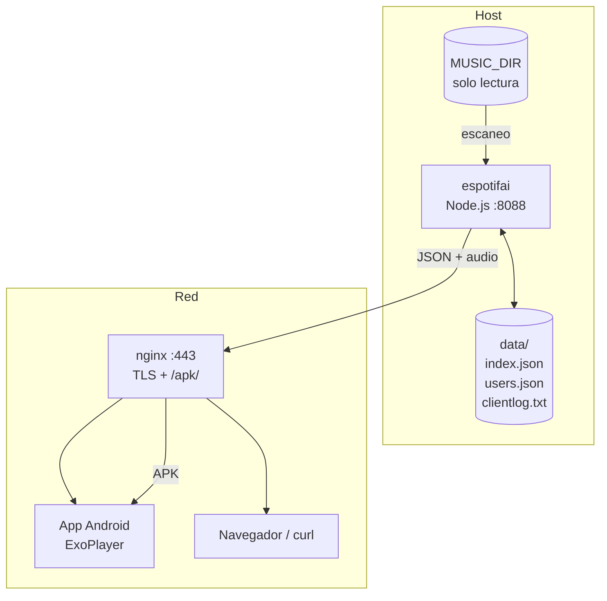

# Arquitectura

## Vista general



## Frontal e instancias

- **Frontal** (`web/`): web estática en `espotifai.es`. Portada del proyecto, documentación, enlace al repo y guía para crear una instancia. No proxya la API ni sirve música.
- **Instancia** (`server/` + `webapp/` + nginx): se despliega en `micasa.espotifai.es`, con un CNAME a la casa de quien la usa. Sirve la app web en `/`, la API en `/api/` y el APK en `/apk/`.
- El CNAME puede apuntar a un DDNS (recomendado si la IP es dinámica) o a una IP fija.
- El frontal y las instancias son independientes: cada instancia tiene su token, su música y su certificado.

## Componentes

### Servidor (`server/server.js`)

Un único proceso Node.js con Express. Al arrancar:

1. Carga el índice de `data/index.json` si existe (arranque rápido).
2. Si no hay índice, escanea `MUSIC_DIR` y lo construye.
3. Queda escuchando en `PORT` (8088 por defecto).

El escaneo (`buildLibrary`) recorre la carpeta, lee las etiquetas con `music-metadata` y agrupa:

```
artista (primer nivel)
└── álbum (directorio del fichero)
    └── pistas
```

Cada pista recibe un `id` que es la **ruta relativa codificada en base64url**. Así el id es estable, seguro para URLs y no revela la ruta absoluta. Las carátulas se buscan por nombres habituales (`cover.jpg`, `folder.jpg`, `front.jpg`…) o por la primera imagen del álbum, y también se codifican como id.

`POST /api/rescan` vuelve a escanear y reescribe `data/index.json`. Con bibliotecas grandes tarda minutos; el cliente debe usar un timeout amplio.

### Streaming

`GET /api/stream/:id`:

- Decodifica el id y comprueba que la ruta resuelta sigue dentro de `MUSIC_DIR` (`isSafeRel`), evitando path traversal.
- Soporta `Range` (206 Partial Content), necesario para el seek del reproductor.
- Devuelve el `Content-Type` según la extensión.

`GET /api/cover/:id` sirve la imagen con caché de un día.

`GET /api/album/:id/zip` genera un ZIP del álbum bajo demanda con `archiver`: pistas + portada. Es la descarga que usa la app web. No hay caché offline: el ZIP se genera en streaming y el navegador lo guarda como fichero.

### Autenticación y usuarios

Hay dos tipos de token:

| Token | Quién | Para qué |
|---|---|---|
| `API_TOKEN` | admin | Usar la API y gestionar usuarios. |
| Token de usuario | familia/dispositivos | Solo usar la API (biblioteca, stream, carátulas, rescan, clientlog). |

- Los usuarios viven en `data/users.json` (`nombre → { token, created, updated }`).
- Los tokens son únicos: no se repiten entre usuarios ni con el admin.
- Si `API_TOKEN` está vacío **y** no hay usuarios, la API queda abierta (cómodo para probar, peligroso en producción).
- `requireAdmin` protege `/api/users`.

El token se acepta en la cabecera `Authorization: Bearer <token>` o en `?token=`. La app usa la cabecera para la API y la query para el stream (el reproductor solo recibe una URL); por eso el token se codifica con `Uri.encode` en la app.

### App web (`webapp/`)

- Un único `index.html` con HTML + CSS + JavaScript, sin build ni dependencias externas.
- Se sirve en `/` de la instancia y llama a `/api/` del mismo origen.
- El token se introduce una vez y se guarda en `localStorage`; las peticiones JSON usan `Authorization: Bearer`, y el audio/carátulas/ZIP usan `?token=` (los elementos multimedia no pueden llevar cabeceras).
- Biblioteca, búsqueda, reproductor con seek, cola y listas (estas en `localStorage`).
- Descarga de álbum: `GET /api/album/:id/zip`. No se guarda audio para offline en la web.

### App Android (`android/`)

- **Kotlin + Jetpack Compose + Media3/ExoPlayer**.
- `MusicViewModel` centraliza biblioteca, reproducción, descargas, cola y listas.
- `PlaybackService` es un `MediaSessionService` con ExoPlayer: reproducción en segundo plano, notificación y controles del sistema.
- `ApiClient` (Retrofit/OkHttp) añade el token a cada petición.
- **Caché offline**: la última biblioteca se guarda en `filesDir/biblioteca.json`; si el servidor no responde se filtra por lo descargado.
- **Descargas**: MediaStore (Android 10+) o fichero directo (8/9), o una carpeta elegida con SAF. Se guarda `trackId → uri` en `SharedPreferences`.
- **Cola**: se refleja desde el `MediaController` (`queue`/`queueIndex`), con operaciones de añadir, insertar a continuación, saltar, quitar y vaciar.
- **Listas**: locales (`SharedPreferences`, JSON con Gson). Guardan las pistas completas para poder mostrarlas y reproducirlas sin conexión. No se sincronizan entre dispositivos.

### nginx

Opcional pero recomendado:

- Termina TLS.
- Sirve la landing (`/`) y los APK (`/apk/`).
- Hace `proxy_pass` al servidor para `/api/*` y el resto.
- `client_max_body_size` debe permitir los logs de fallo (256 KB) y los JSON.

## Ficheros de datos

| Fichero | Contenido | Versionado |
|---|---|---|
| `data/index.json` | Índice de la biblioteca | No |
| `data/users.json` | Tokens de usuario | No |
| `data/clientlog.txt` | Trazas de fallo de la app | No |

Todo `data/` está en `.gitignore`.

## Decisiones de diseño

- **Sin base de datos**: un JSON es suficiente para una biblioteca doméstica y simplifica el despliegue.
- **Música solo lectura**: el servidor nunca escribe en `MUSIC_DIR`.
- **Ids base64url**: estables, opacos y seguros para URL.
- **`safeInt` en metadatos**: un MP3 corrupto puede devolver un bitrate enorme que no cabe en un `Int` de 32 bits; se acota para que no rompa el parseo de toda la biblioteca en la app.
- **Dos direcciones en la app**: LAN y pública, configurables al compilar; si una falla, prueba la otra.
- **Listas locales**: no requieren cambios en el servidor y funcionan sin conexión; el precio es que no se sincronizan.
